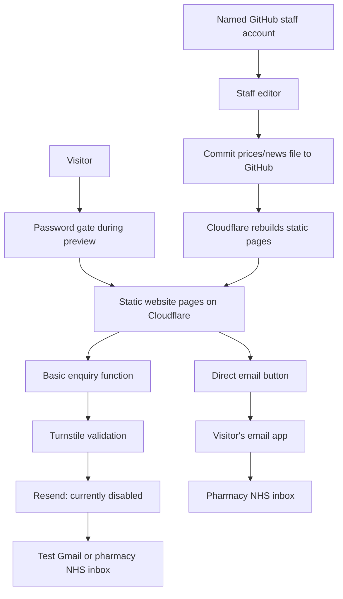

# How the database-free website works

## What is stored

- `content/site-content.json` stores prices, news and unpublished drafts in the Git repository. Git commits provide change history and recovery. Use a private repository: unpublished does not mean secret if the source repository is public. Never enter patient information into news or content fields.
- GitHub owns hosted staff identities and passwords. Our editor receives a limited GitHub App user token, seals it in an encrypted HttpOnly session cookie for up to eight hours, and checks the approved-editor list and repository write access on each operation. Tokens are not stored in browser JavaScript/localStorage or a website database. Sign-in uses state and PKCE; no refresh tokens are retained.
- A separate encrypted cookie remembers preview viewing access for eight hours. Long random viewing passwords and session secrets live in hosting secrets. Rotating the viewing password invalidates viewing cookies; rotating SESSION_SECRET invalidates staff sessions. Sign-out clears cookies in that browser, not copied cookies elsewhere. Remove a departing editor from GITHUB_EDITORS and GitHub repository access to revoke editing.
- Basic enquiries exist only while the function validates and forwards them. No messages, phone numbers or email queue are saved in the repository or by the application. Resend, Cloudflare security/request metadata and the receiving mailbox have their own processing/retention arrangements.
- Sensitive enquiries sent using mailto pass through the visitor's email service and NHS mailbox, not our function or Resend. A visitor can still put sensitive text in the basic-enquiry box despite its warning; the checkbox is not a guarantee.

## Staff workflow

Open `/admin`, sign in with an approved GitHub account, change prices or news, then save. Saving commits one fixed content file on the configured branch using that user's token. The editor supplies the file's SHA, so a competing change causes a conflict instead of a silent overwrite. Copy your edits before reloading after a conflict.

Cloudflare's Git integration builds after the commit. Changes are not public until deployment succeeds; the previous deployed site remains if a build fails. There is no instant-publishing claim or build-status monitor in the editor. The owner checks deployment failures in Cloudflare. Each save can use a build allowance: make related edits together. Git history records edits; it is not a complete snapshot comparison UI or an independent backup.

The local editor is intentionally different: it works on a local JSON file and immediately rebuilds, with a separate generated staff password. It binds only 127.0.0.1, refuses unexpected Host headers and cannot be enabled remotely by a runtime flag alone. Local edits are not automatically committed or pushed. Its local recent-change list resets when the process restarts.

## Enquiries and failure behaviour

The form gets a short-lived signed/encrypted request ticket. The function checks allowed fields, origin, basic-enquiry acknowledgement, body size, honeypot, ticket and Turnstile. Production requires Turnstile on both preview-password submission and the contact form. Simple per-instance rate limits add protection but are not a distributed quota; configure Cloudflare edge controls if abuse occurs.

Resend receives a fixed server-controlled recipient and the visitor's address as Reply-To. An idempotency key is reused when retrying the unchanged message on the same page, within the ticket's one-hour life. Changing the message obtains a new ticket; refreshing the page also creates a new request and may duplicate an earlier message. A timeout can mean acceptance is unknown. Nothing will be retried automatically after the visitor leaves.

After the enquiry is accepted, a separate acknowledgement is sent without repeating the message, name, email address or telephone number. Test mode routes both emails to TEST_EMAIL (default `pharmacy.testing19@gmail.com`); live mode forwards to the NHS pharmacy inbox and acknowledges the visitor. No test copy is sent in live mode. The acknowledgement uses its own stable idempotency key so an unchanged retry can recover from a partial send without duplicating an accepted email. A failed acknowledgement is reported separately from a failed enquiry. Callback requests require a telephone number and are marked in the forwarded enquiry; they do not book an appointment.

The contact and privacy pages link to [NHS England's explanation of confidential patient information](https://digital.nhs.uk/services/national-data-opt-out/understanding-the-national-data-opt-out/confidential-patient-information). They distinguish general contact details (still personal information) from identifiable health or treatment details, which must be discussed directly with the pharmacy rather than entered in this form.

An accepted response means Resend accepted the request, not that the email arrived. Failures are shown with phone/email alternatives. Provider delivery/bounce checks belong in Resend; there is no database queue dashboard now.

## Hosting and expected cost

Target: Cloudflare Workers Free with Static Assets, GitHub repository and GitHub App, Turnstile, and Resend's free allowance. No database subscription or always-running Node server is needed. Node is used to build the HTML and run local development, not as a rented persistent process.

As checked on 29 October 2026, Workers Builds Free includes 3,000 build minutes/month. Worker invocations count towards the Workers free request allowance. All requests currently pass through the worker to preserve preview protection, including assets. Free limits and provider terms may change. This is a design intended to fit free tiers at modest usage, not a promise of unlimited or permanently free service. Domain renewal remains payable. Check Resend's current email allowance when creating the account.

Workers routing is configured with `[assets].run_worker_first = true`. The Worker checks preview access before fetching any static asset. This replaces the Pages-specific fail-open/closed setting and \_routes.json; neither is used now. Do not change to asset-first routing. The server bundle lives outside the public assets folder. Configure staging separately with distinct secrets and exact SITE_ORIGIN. Unknown hosts fail closed; additional aliases require deliberate configuration.

## Security and maintenance boundaries

The GitHub App should be installed on only the website repository, with Contents read/write and Metadata read. Staff must also have repository write access, so they can edit repository code through GitHub outside the restricted website editor. Do not grant this access to someone you trust only to change prices; use a different identity/content arrangement if finer permissions are needed. GitHub MFA protects named accounts; configure it during onboarding.

No external security audit has been performed. Live GitHub authentication, Cloudflare quotas/settings, Turnstile and actual email delivery must be tested on the configured host. Automated tests now run Cloudflare’s actual local workerd runtime and asset router; this verifies Worker-first protection and route serving locally, not hosted account settings.

Routine maintenance remains: review failed builds and bounced emails, revoke departed staff, keep dependencies/runtime supported, renew the domain and retain a separate repository backup. Pharmacy staff can manage prices/news independently.

## References

- [Workers Builds limits](https://developers.cloudflare.com/workers/ci-cd/builds/limits-and-pricing/)
- [Workers free limits](https://developers.cloudflare.com/workers/platform/limits/)
- [Worker-first asset routing](https://developers.cloudflare.com/workers/static-assets/binding/#run_worker_first)
- [GitHub App user authentication](https://docs.github.com/en/apps/creating-github-apps/authenticating-with-a-github-app/generating-a-user-access-token-for-a-github-app)
- [Resend pricing](https://resend.com/pricing)
